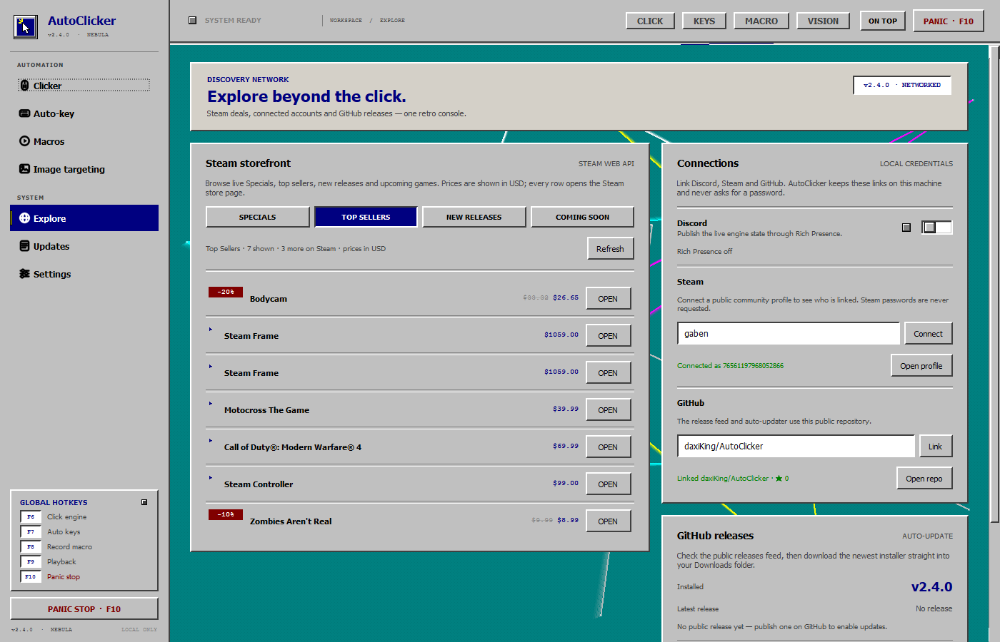

# AutoClicker

**v2.4.0 "Nebula"** — a retro Windows 95/98-style automation console for Windows and Linux.
Auto clicks, auto keys, macro recording, image-targeted clicking, Discord Rich Presence,
a Steam storefront explorer and GitHub-powered updates.

> Legitimate automation only. AutoClicker sends synthetic input and matches pixels on
> your own screen; it does not read game memory, bypass anti-cheat, or implement aimbots,
> aim assist or wallhacks.



## Highlights

- **Click engine** — 1–1,000 CPS with paced or uncapped burst clicking, jitter, chaos,
  multi-position patterns, auto-stop limits, click sound and a foreground-window filter.
- **Auto-key** — any virtual key, hold duration, up to 500 presses per second, press or
  duration limits.
- **Macro studio** — unlimited-duration recording, infinite playback, speed control,
  JSON import/export and a persistent macro vault.
- **Image targeting** — build a library of target images, scan the screen for the best
  match, use exact-color or grayscale matching, test a match without clicking, and stop
  after N clicks. PNG, JPG, WebP, GIF, TIFF, BMP, ICO and SVG are accepted.
- **Discord Rich Presence** — publishes the live engine state, session timer and a
  GitHub link through Discord's local IPC socket. Toggle it in **Explore → Connections**.
- **Explore tab** — live Steam Specials, top sellers, new releases and coming-soon rows,
  with discount badges, USD prices and store links.
- **Connections** — link a public Steam community profile (no password) and the GitHub
  repository used by the updater.
- **GitHub auto-updates** — compares the installed build with the newest public release,
  downloads the installer into your Downloads folder and checks quietly on startup.
- **43 interface languages** — choose a locale in **Settings → Behavior**; untranslated
  strings fall back to English.
- **Linux support** — a `pynput` X11/Wayland backend, platform-aware settings, a
  `.desktop` entry and GitHub Actions builds for Windows and Linux.

## Install

### Windows

Download `AutoClicker-Setup-2.4.0.exe` from the
[Releases page](https://github.com/daxiKing/AutoClicker/releases/latest) and run it.
The installer places the app under `%LOCALAPPDATA%\Programs\AutoClicker`, creates a
desktop shortcut and keeps settings, macros and images in the portable `data\` folder
next to the executable.

### Linux

Download the Linux tarball from Releases, then:

```bash
tar -xzf AutoClicker-2.4.0-linux-x86_64.tar.gz
./AutoClicker/AutoClicker
```

To add a menu entry, copy `AutoClicker.desktop` and `autoclicker.png` into your local
applications folder and adjust `Exec=` to the extracted path:

```bash
mkdir -p ~/.local/share/applications ~/.local/share/icons
cp AutoClicker.desktop ~/.local/share/applications/
cp autoclicker.png ~/.local/share/icons/
```

X11 is the best-supported session. On Wayland, synthetic input depends on the
compositor and XWayland; global hotkeys and window-title filtering may be limited.
Scan-code mode, process priority and administrator relaunch are Windows-only and are
disabled automatically on Linux.

## Build from source

Requirements: Python 3.11+ on Windows or Linux.

```bash
python -m pip install -r requirements.txt pyinstaller
python -m compileall -q novaclick main.py
```

### Windows executable + installer

```powershell
python -m PyInstaller --noconfirm --clean --windowed --name AutoClicker `
  --icon "$PWD\build\autoclicker.ico" --version-file "$PWD\build\version_info.txt" `
  --distpath build\dist --workpath build\work --specpath build main.py

& "$env:LOCALAPPDATA\Programs\Inno Setup 6\ISCC.exe" build\AutoClicker.iss
```

The installer is written to `build\installer\AutoClicker-Setup-2.4.0.exe`.

### Linux bundle

```bash
bash build/build_linux.sh
```

The portable folder lands in `build/dist-linux/AutoClicker` and the tarball in
`build/AutoClicker-2.4.0-linux-x86_64.tar.gz`.

The GitHub Actions workflow in `.github/workflows/build.yml` builds both platforms on
every push to `main` and on pull requests. Pushing a `v*` tag also publishes the Windows
installer and the Linux tarball to the GitHub Releases page, which is the feed the
in-app updater reads.

## Discord Rich Presence

Rich Presence uses AutoClicker's own public Discord application client ID and Discord's
local IPC transport (`\\.\pipe\discord-ipc-*` on Windows,
`$XDG_RUNTIME_DIR/discord-ipc-*` on Linux). The app never asks for or stores a Discord
user token. Activity fields include:

- the current engine state (`SYSTEM READY`, `CLICK ENGINE LIVE`, `PLAYING MACRO`, …);
- a session start timestamp;
- a link to this repository.

If Discord is not running, the service retries quietly in the background; the engine is
never affected.

## Steam storefront and connections

Explore fetches Steam's public featured-categories feed
(`store.steampowered.com/api/featuredcategories`). It is a read-only, anonymous request.
Prices are shown in USD and every row opens the corresponding store page. Steam profile
linking reads the public community XML feed for a vanity name or SteamID64; no Steam
password, cookie or API key is involved. GitHub linking reads the public repository
metadata used by the updater.

## Updates

The updater queries `https://api.github.com/repos/daxiKing/AutoClicker/releases/latest`,
compares semantic versions, and downloads the preferred installer asset into
`~/Downloads` (Windows: `%USERPROFILE%\Downloads`). Startup checks are on by default and
can be disabled in **Explore → GitHub releases**. No credentials are stored; set
`GITHUB_TOKEN` in the environment only if you point the app at a private mirror.

## Privacy

- Settings, macros, images and logs stay under `data\` next to the app.
- Screen captures used by image targeting are processed in memory on this machine.
- Network access is limited to the Steam storefront feed, Steam community XML, the
  GitHub API and Discord's local IPC socket.
- No analytics, telemetry or accounts are created.

## Project layout

```
novaclick/
  core/        input backends, engines, image matching, presence, updater, i18n
  ui/          retro shell, pages, widgets and theming
build/         PyInstaller/Inno Setup assets and Linux packaging
.github/       CI workflows
main.py        application bootstrap
```

## Responsible use

Use AutoClicker only where automation is permitted. Respect the terms of service of the
games, applications and services you use it with. The project intentionally excludes
game cheats, anti-cheat bypasses and anything that gives an unfair competitive advantage.

## License

MIT © 2026 daxiKing. See [LICENSE](LICENSE).
